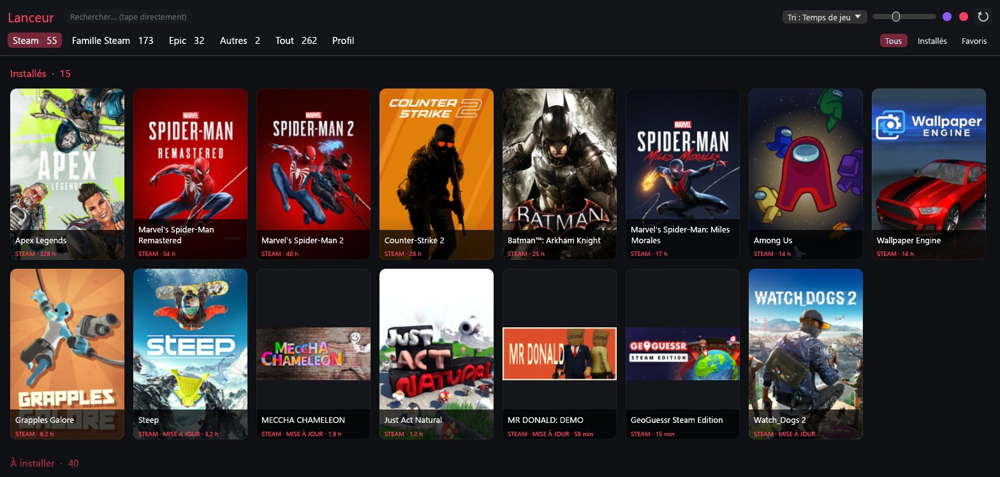
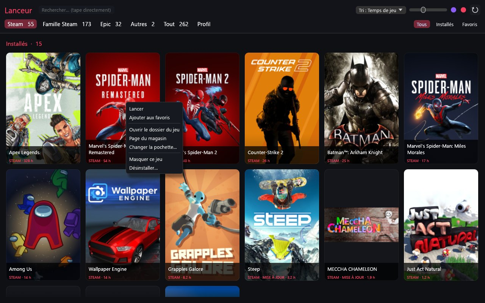
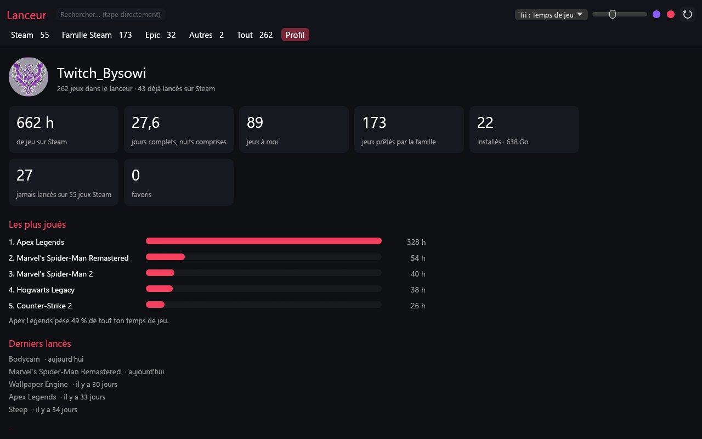

# Lanceur

Une seule fenêtre, légère, pour lancer ses jeux **Steam, Epic Games, Roblox et Minecraft** (et ce qu'on ajoute à la main) sous Windows.

Lanceur ne remplace pas Steam ni Epic : il lit leurs fichiers locaux pour dresser la liste, puis leur demande de lancer le jeu, comme le ferait un raccourci.



## Télécharger

**[Lanceur-windows.zip](https://github.com/Pierre-Dunand-Chatellet/Lanceur/releases/latest/download/Lanceur-windows.zip)** (2,8 Mo, Windows 10 / 11) : dézipper, lancer `Lanceur.exe`, rien à installer. Il faut Steam ou Epic Games sur le PC, lancé au moins une fois.

L'exécutable n'est pas signé : Windows peut afficher « Windows a protégé votre ordinateur ». Cliquer sur « Informations complémentaires » puis « Exécuter quand même ». Le fichier [`LISEZMOI.txt`](LISEZMOI.txt) explique le reste.

Page de présentation : <https://dunandchatellet.fr/lanceur/>

## Ce qu'il fait

- Onglets par provenance : Steam, Famille Steam, Epic, Autres, Tout.
- Jeux installés et à installer dans deux blocs ; un clic sur un jeu non installé lance son installation.
- Temps de jeu et dernier lancement lus dans les données de Steam ; tri par nom, par récents ou par temps de jeu.
- Clic droit : ouvrir le dossier, page du magasin, changer la pochette, masquer, désinstaller.
- Clavier : taper pour chercher, flèches et Entrée pour lancer, Échap pour effacer, F5 pour rescanner.
- Profil : heures totales, jeux les plus joués, derniers lancés, réglages et diagnostic.
- Se réduit ou se ferme au lancement d'un jeu, au choix ; retient la taille de la fenêtre.





## Comment ça marche

- **Rust** avec [eframe / egui](https://github.com/emilk/egui) (OpenGL). Un seul fichier source, `src/main.rs`. L'exécutable pèse 6 Mo et ne dépend que de Windows.
- **Steam** : la liste complète vient du cache local (`appcache/appinfo.vdf` et `packageinfo.vdf`), les jeux installés des manifestes `appmanifest_*.acf`, le temps de jeu de `userdata/<compte>/config/localconfig.vdf`. Le compte est celui marqué `MostRecent` dans `config/loginusers.vdf`. Aucun compte à saisir, aucune clé d'API.
- **Famille Steam** : Steam ne dit pas en local quels jeux non installés sont prêtés par la famille. Les jeux d'une collection Steam au choix (par défaut « Mes jeux ») sont considérés comme « à moi », le reste comme familial. Les jeux installés d'un autre compte sont reconnus par `LastOwner`.
- **Epic** : manifestes et cache du catalogue du lanceur Epic (`%ProgramData%\Epic\EpicGamesLauncher\Data`). La liste « à installer » vient de ce cache : elle peut contenir des jeux qu'on ne possède pas. Epic ne garde pas le temps de jeu sur le PC.
- **Pochettes** : cache de Steam, puis serveurs d'images de Steam et d'Epic (`curl.exe`), puis le dossier du jeu ; gardées dans `%LOCALAPPDATA%\Lanceur\covers`. Rien d'autre n'est envoyé.
- **Réglages** : `%APPDATA%\Lanceur\state.json`.
- Variable d'environnement `LANCEUR_STEAM` pour imposer le dossier de Steam (installation hors norme, essais).

## Compiler

Il faut la chaîne Rust (cible `x86_64-pc-windows-gnu` ou `-msvc`) :

```
cargo build --release
cargo test --release
cargo test --release -- --ignored --nocapture   # essai sur le vrai PC : dépend de l'installation Steam/Epic
```

## Limites

- Windows uniquement.
- Essayé jusqu'ici sur un seul PC. Si Steam change le format de son cache, un bandeau le dit et seuls les jeux installés sont listés.
- GOG, EA, Ubisoft Connect et Battle.net ne sont pas détectés : « Ajouter un jeu… » dans le Profil.

## À propos

Application **codée avec l'IA** (Claude) : je ne programme pas en Rust. Le besoin, les couleurs, la séparation des jeux et les essais sur ma propre bibliothèque sont de moi. Voir [Pierre Dunand-Chatellet](https://dunandchatellet.fr/).

Les pochettes appartiennent à leurs éditeurs ; Steam et Epic Games sont des marques de leurs propriétaires. Aucune licence n'est donnée pour l'instant.
